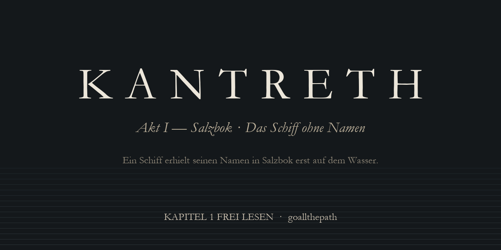

 

**[📖 Kapitel 1 online lesen](buch/kapitel-01-der-letzte-stapellauf.md)** &nbsp;·&nbsp;
**[⬇ PDF (A5, 14 Seiten)](buch/KANTRETH_Kapitel_01_Der_letzte_Stapellauf.pdf)** &nbsp;·&nbsp;
**[💬 Leserstimme hinterlassen](https://github.com/goallthepath/KANTRETH/issues/new?template=leserstimme.yml)**

Deutschsprachiger Roman · Leseprobe · frei weitergebbar unter CC BY-NC-ND 4.0

---

> *Ein Schiff erhielt seinen Namen in Salzbok erst auf dem Wasser.*
> *Vorher war es Holz, Arbeit und Möglichkeit.*

## Salzbok

Ein krummer Rücken aus Lehm, Feldstein und alten Deichen. Zwei Reihen Häuser, eine Seilerbahn, ein Räucherhof, eine Werft. Bei Ebbe suchen Kinder im Schlick nach Kupferscheiben, und die Erwachsenen rufen ihnen vom Kai aus zu, dass das verboten ist.

Sechs Tage vor dem Stillstand beginnt in Salzbok niemand mehr etwas, das sich nicht sicher beenden lässt. Vor dem Kettenhaus werden Zinkplatten blank gerieben. Manche tragen Namen. Andere bleiben leer.

Hinten in der Werft der Brandwerths steht ein Rumpf, den niemand bestellt hat. **Theodor** baut seit sieben Jahren daran – vor Sonnenaufgang, nach Feierabend, an Nachmittagen, an denen Kunden nicht kommen. Kein Vertrag, kein Käufer, kein Name. Im Werkbuch steht dazu nur: *Zweck offen.*

Dann kehrt sein Bruder **Wolfram** aus dem Norden zurück, auf einem Murnner, dessen Geweih nicht unter die Trossen passt. Mit einer neuen Narbe unter dem Auge. Und mit Holz.

*Für das Schiff?*
*Vielleicht.*

---

## Was dieses Buch ist

KANTRETH ist ein leiser Roman über eine grosse Frage: **Was trägt eigentlich – ein Schiff, ein Dorf, eine Welt, zwei Menschen?**

Hier gibt es keine Auserwählten und keine Prophezeiung, die man auswendig lernen müsste. Es gibt Arbeit. Hände, die wissen, wann ein Balken *passt* und wann er *liegt*. Menschen, die fast nie sagen, was sie meinen – gerade dann nicht, wenn es wichtig ist.

Die Welt wird nicht erklärt. Sie wird dir überlassen.
Was dir auf Seite drei seltsam vorkommt, ist kein Fehler. Es ist eine Tür, die später aufgeht.

Ich nenne das **poetischen Ingenieurrealismus**: literarische Ruhe statt Dauersensation, eine Welt mit innerer Mechanik statt beliebiger Magie, Tiefe, die nicht schwer sein will.

Wenn du Bücher magst, in denen Menschen arbeiten, schweigen und sich trotzdem verstehen – lies die ersten zwei Seiten. Du merkst schnell, ob es dich trägt.

---

## Lesen

| | |
|---|---|
| 📖 **Online** | [Kapitel 1 · Der letzte Stapellauf](buch/kapitel-01-der-letzte-stapellauf.md) – direkt hier im Browser, ca. 20 Minuten |
| 📄 **PDF** | [Buchsatz A5, Garamond](buch/KANTRETH_Kapitel_01_Der_letzte_Stapellauf.pdf) – für E-Reader, Tablet oder zum Ausdrucken |
| 🏷 **Release** | [Alle Versionen](https://github.com/goallthepath/KANTRETH/releases) |

---

## Deine Stimme trägt mit

Ein Buch wird erst fertig, wenn jemand es liest. Bis dahin ist es – wie der Rumpf in der Hinterhalle – Holz, Arbeit und Möglichkeit.

Ich freue mich über jede ehrliche Rückmeldung. Nicht Lob, nicht Verriss – **Wahrnehmung**:

- **Wo hast du aufgehört zu lesen?** (Das ist die wertvollste Information überhaupt.)
- **Welcher Satz, welche Geste ist hängen geblieben?**
- **Wo bist du gestolpert** – über ein Wort, einen Namen, einen Satz?
- **Welche Frage nimmst du mit** ins nächste Kapitel?

👉 **[Leserstimme hinterlassen](https://github.com/goallthepath/KANTRETH/issues/new?template=leserstimme.yml)** – ein kurzes Formular, dauert zwei Minuten.
💬 Lieber im Gespräch? → [Diskussionen](https://github.com/goallthepath/KANTRETH/discussions)
⭐ Wenn dich das Kapitel berührt hat: ein **Stern** zeigt mir, dass jemand da war. Und hilft anderen, das Buch zu finden.
🔁 **Teile es.** Die Lizenz erlaubt ausdrücklich, das PDF weiterzugeben – an Freunde, in Lesekreise, Foren, Schulklassen.

---

## Stand

- [x] **Kapitel 1 – Der letzte Stapellauf** · frei veröffentlicht
- [ ] Akt I – Salzbok · in Überarbeitung

Wie schnell es weitergeht, hängt auch davon ab, ob hier jemand liest. Beobachte das Repository (**Watch → Custom → Releases**), dann erfährst du es als Erste·r.

---

## Lizenz

© 2026 **goallthepath**

Der Text steht unter **[Creative Commons BY-NC-ND 4.0](LICENSE)** ([verständlich auf Deutsch](https://creativecommons.org/licenses/by-nc-nd/4.0/deed.de)):

- ✅ **Teilen** – kopieren, weitergeben, drucken, in jedem Format
- ✅ **mit Namensnennung** – „KANTRETH von goallthepath“ + Link hierher
- ❌ **nicht kommerziell** – kein Verkauf, keine bezahlten Angebote
- ❌ **keine Bearbeitungen** – der Text bleibt, wie er ist

Die Welt KANTRETH, ihre Orte, Namen, Figuren und Sprachen bleiben Werk des Autors. Für Übersetzungen, Lesungen, Verlagsanfragen oder alles andere: [schreib mir](https://github.com/goallthepath/KANTRETH/discussions).

---

<b>🌍 For English readers</b>

 

**KANTRETH** is a German-language literary novel. This repository publishes **Chapter 1 – “The Last Launch”** of *Act I: Salzbok – The Ship Without a Name* for free.

In a small harbour town built on an old dyke, six days before “the Stillness”, shipwright Theodor has spent seven years building a hull no one ordered. His brother Wolfram returns from the north with a new scar and a load of timber. The world is never explained – it is discovered: through work, repetition, objects and what people leave unsaid.

If you read German, the chapter takes about 20 minutes. If you don’t, tell us – that is feedback, too. Stars, shares and [reader notes](https://github.com/goallthepath/KANTRETH/issues/new?template=leserstimme.yml) are warmly welcome.

Licensed under CC BY-NC-ND 4.0 · © 2026 goallthepath

---

Geschrieben, gesetzt und geteilt von <a href="https://github.com/goallthepath"><b>goallthepath</b></a>.
 
<i>Nicht das Einzelne trägt. Es trägt dazwischen.</i>

